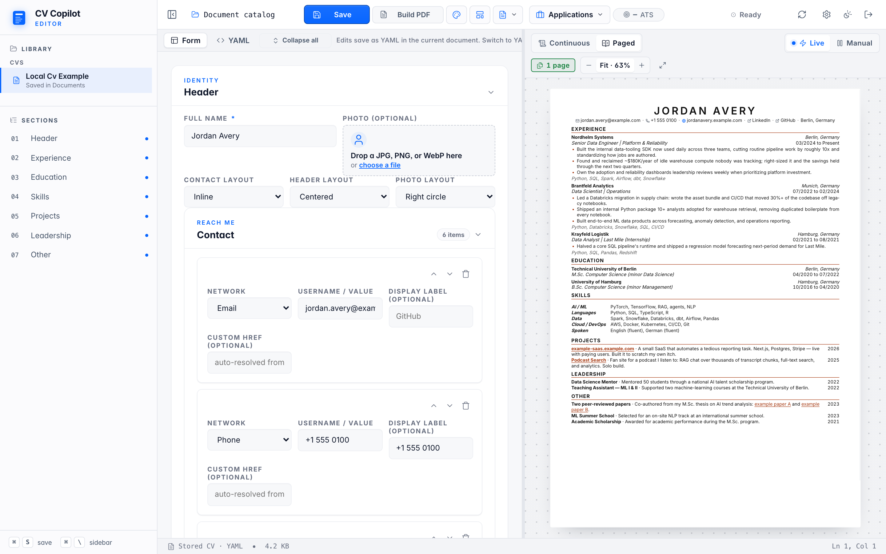
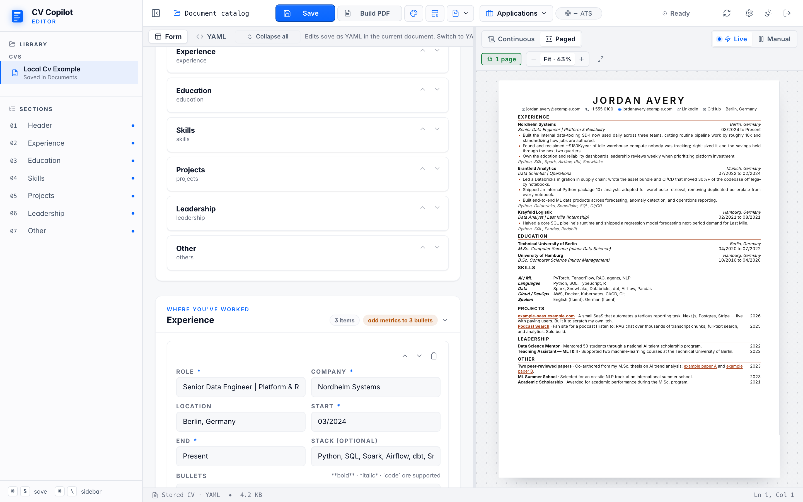
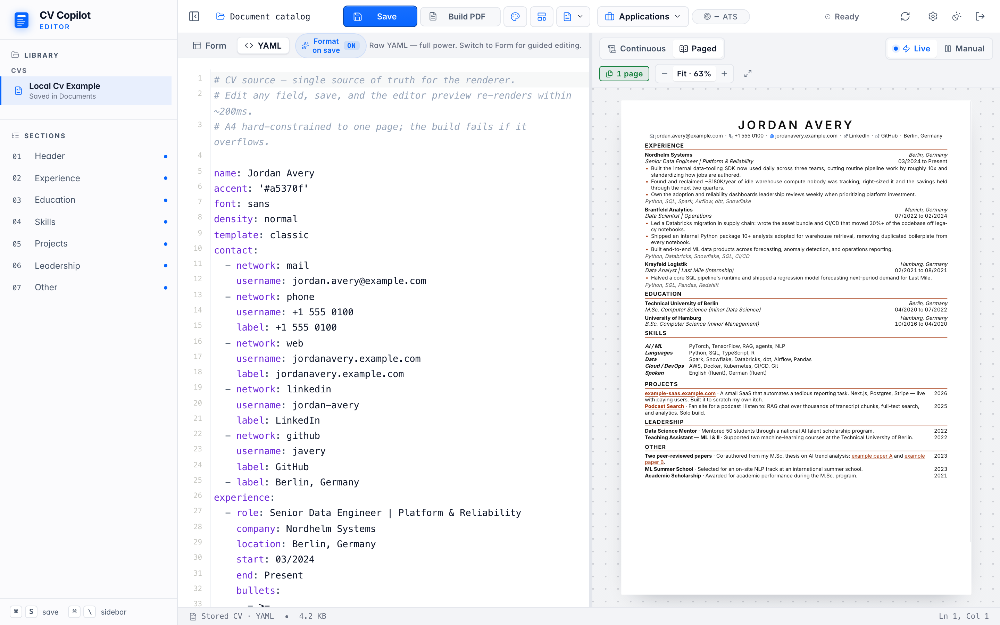
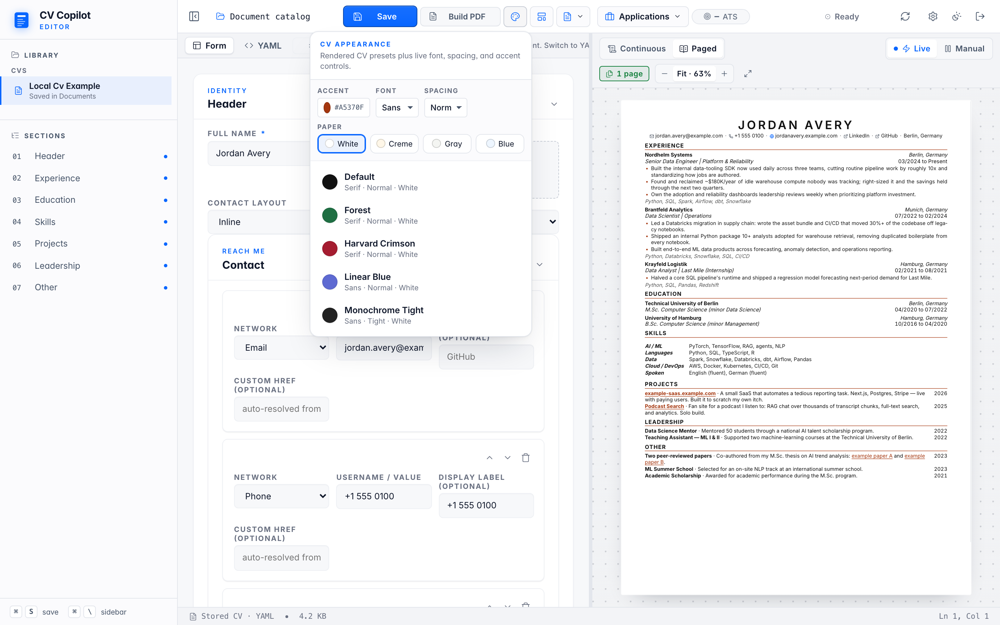
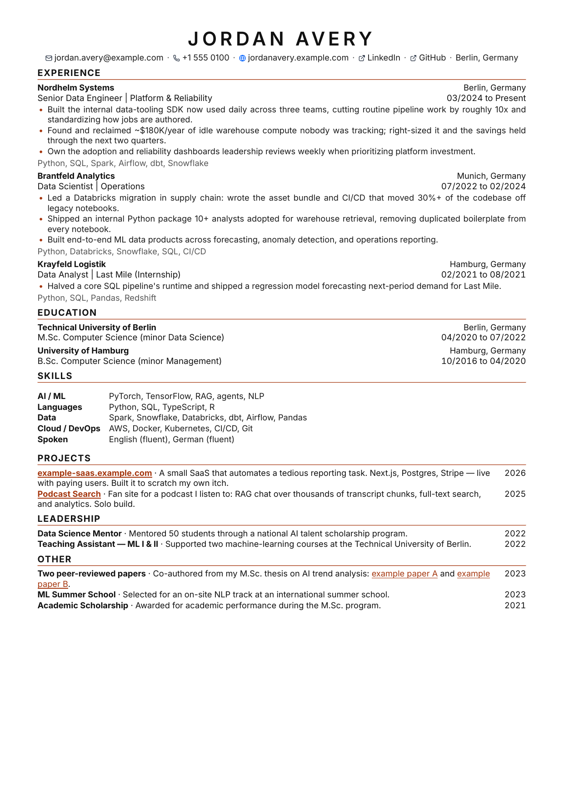
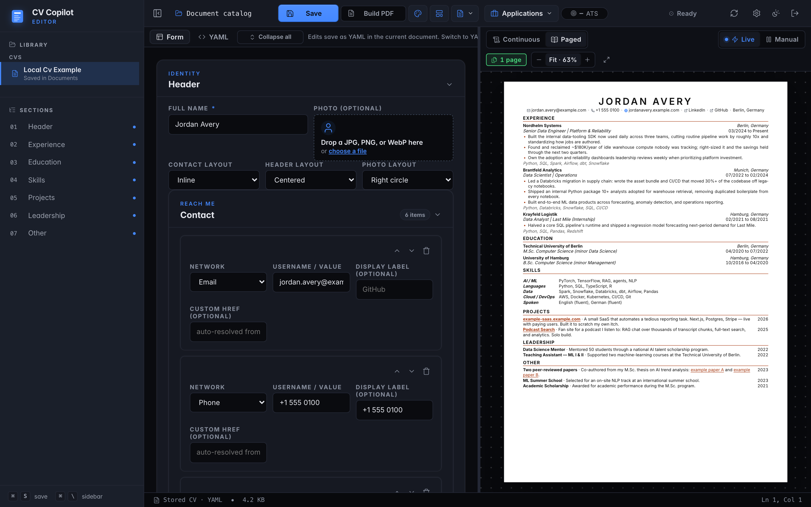

<div align="center">



# CV Copilot

### Your AI-native résumé copilot — **one page, or the build fails.**

[](LICENSE)
[](https://www.python.org)
[](#what-makes-it-ai-native)
[](#one-page-enforced)
[](https://github.com/loehrning-ai/cv-engine/actions/workflows/ci.yml)
[](#where-your-data-goes)

**Form on the left. Live A4 on the right. Claude on tap.** Drop your old PDF, tailor it to a job, ship a one-page CV that never spills to page two.

[Try the demo](#try-the-demo-in-30-seconds) · [Run it](#run-it) · [Why AI-native](#what-makes-it-ai-native) · [One page, enforced](#one-page-enforced) · [Where your data goes](#where-your-data-goes) · [Compared to](#compared-to)

</div>

---

## The 15-second version

A CV is a small document with a brutal constraint: **one page, A4, in a layout every recruiter has already internalised.** Most tools miss the constraint entirely. Word fights you on every paragraph. Figma is pixel-pushing in disguise. LaTeX is a weekend. The AI resume sites generate a wall of text and let you print four pages of it.

CV Copilot is the missing middle — a deterministic local YAML-to-PDF build plus a structured web editor with a `paged.js` preview, both hard-constrained to one page. **The AI does the tedious parts: reading your old CV, tailoring bullets to a job, drafting the cover letter, scoring for ATS.** You keep the taste. The build refuses to emit a two-pager.

> **It has three explicit storage modes.** The CLI reads a local, gitignored YAML file and writes a PDF without network access. The zero-config browser demo keeps its sample and edits only in process memory, so a server restart resets it. The durable web editor is self-hosted and multi-tenant, with Supabase auth and per-user document storage, an AES-GCM vault for provider keys, optional R2-backed PDFs, and GDPR export. See [`DEPLOY.md`](DEPLOY.md).

---

## What makes it AI-native

Four AI actions, every one grounded in *your* content and *your* provider. Nothing runs in the background; each is an explicit click.

| | What it does | Grounded in |
|---|---|---|
| **📥 Import** | Drop a PDF, DOCX, or paste any résumé text → the model maps it straight into the schema. | Your existing CV |
| **🎯 Tailor** | Paste a job posting → get a review-first rewrite that reweights bullets to the role. Nothing auto-applies. | Your CV + the posting you pasted |
| **✉️ Cover letter** | Generate a grounded letter with structured envelope fields and an editable body. | Your CV + the job |
| **📊 ATS score** | A transparent, deterministic keyword/structure simulation — see *why* a line scored, not a black-box number. | Your CV + the posting |

**You choose the model.** Anthropic (Claude) is the only operator-funded managed-credit provider; Gemini, Ollama, OpenRouter, DeepSeek, Groq, Mistral, and any OpenAI-compatible endpoint are **bring-your-own-key** or local. Point it at `ollama` and the request never leaves your machine. See [Providers](#providers).

> **On job import:** you paste the posting text or URL — CV Copilot does **not** blind-scrape LinkedIn. Ingestion runs only through compliant, auditable paths; URL fetching is off unless you allowlist a host. Details: [`docs/job-ingestion-policy.md`](docs/job-ingestion-policy.md).



---

## One page, enforced

This is the whole point — and it's load-bearing. Everything else (the AI, the themes, the fonts, the densities) is in service of a single constraint.

**Build-time.** `python3 engine/build.py` runs WeasyPrint to PDF, counts pages, and exits non-zero if there's more than one:

```
❌ CV overflowed to 2 pages.
   First section on the overflow page: 'Education'.
   Try: --density tight, or trim a bullet in content/cv.yaml.
```

The overflow heading comes from walking WeasyPrint's bookmark tree to the first heading whose target page index `> 0`. **You always know which section pushed it over.** Wire it into CI and a two-page CV fails the build like any other regression.

**Editor-time.** Toggle **Paged** mode in the preview header. `paged.js` paginates live inside the iframe. Any page after the first gets a 4-px red outline; the page-count pill flips from green `1 page` to red `Overflow · 2 pages` with a one-shot shake — the exact moment in the banner above. **You see the bullet that tipped you over.**

To recover, in order of impact:

1. Switch density to **tight** (~12% vertical space back)
2. Trim adjectives, favour numbers (`50%+`, `100+ hours/week`)
3. Merge or drop older entries
4. Last resort: drop the `stack:` line on older roles

---

## Try the demo in 30 seconds

No account, no API key, no cloud setup — the demo seeds a sample CV and runs entirely on your machine:

```bash
git clone https://github.com/loehrning-ai/cv-engine.git && cd cv-engine
python3 -m pip install --require-hashes -r requirements.lock
ONEPAGER_DEMO_MODE=true python3 tools/editor/server.py
# → http://127.0.0.1:5567 — click "Demo login"
```

The demo is intentionally ephemeral. Autosave survives page reloads while the
server process is running, but it writes to process memory, not
`content/cv.yaml`; stopping the server discards demo CVs, jobs, letters, and
other account-scoped state. Use the editor's PDF download for the current demo
document. The CLI build is a separate file-backed path. A user-triggered theme
URL import is deliberately disabled; shipped theme presets remain read-only.

Demo mode is code-enforced as loopback-only. A public `PUBLIC_BASE_URL`, public
Host, or non-loopback peer is refused. Optional Supabase demo grants require
explicit `DEMO_EMAIL` and `DEMO_PASSWORD`; without both, the demo remains local.

Hosted deployments require an explicit `ONEPAGER_PRIVACY_CONTACT`. The
production Compose profile also runs the service-role account-erasure worker:
at D+30 it removes the account's R2 prefix and exact photo directory before
hard-deleting the Supabase Auth user and cascading owned database rows.

(WeasyPrint needs Pango/Cairo — `brew install pango` on macOS, `sudo apt install libpango-1.0-0 libpangoft2-1.0-0 libcairo2` on Debian/Ubuntu.)

## Run it

From a checkout, on Python 3.13+, the durable local path is the CLI:

```bash
python3 -m pip install --require-hashes -r requirements.lock

# Keep personal source data in the gitignored local file.
cp content/cv.example.yaml content/cv.yaml
# Edit content/cv.yaml with your normal editor, then render it.
python3 engine/build.py
open output/cv.pdf
```

To explore the form and live preview without configuring Supabase:

```bash
ONEPAGER_DEMO_MODE=true python3 tools/editor/server.py
# → http://127.0.0.1:5567
```

Those browser edits are process-local and are not consumed by
`python3 engine/build.py`. Download the PDF from the demo UI before stopping
the process. For durable form-based editing, configure the Supabase-backed
self-hosted mode in [`DEPLOY.md`](DEPLOY.md).

Turn on the copilot in the local demo by adding a key (Anthropic shown; any
provider works):

```bash
export ANTHROPIC_API_KEY="sk-ant-…"
ONEPAGER_DEMO_MODE=true python3 tools/editor/server.py
```

**Durable local YAML → one-page PDF:**

1. Install Pango/Cairo above, then `python3 -m pip install --require-hashes -r requirements.lock`
2. Copy `content/cv.example.yaml` to the gitignored `content/cv.yaml`.
3. Edit that YAML locally.
4. Run `python3 engine/build.py` → `output/cv.pdf`. **One page or it fails.**

No AI key? The CLI render, demo form, live preview, templates, deterministic
ATS scoring, and PDF builds still work. Deterministic import supports
`rendercv` YAML and plain text. Provider-backed import, tailoring, and cover
letters require the selected provider path.

---

## The loop



The editor is two panes. The **form** on the left renders the active document's
YAML model. In zero-config demo mode that document lives only in process
memory; in self-hosted mode its `yaml_blob` is stored in the caller's
RLS-scoped Supabase row. Cards animate in and out as you add or remove entries.
Every list — experience, education, skills, projects, leadership, others — has
the same shape: a card per item, fields inside, up / down / delete in the
corner. Cmd+S saves to the active storage backend; Cmd+Z undoes across the
in-browser model. No JSON-edits-in-disguise.

The **preview** on the right is `paged.js` in an iframe, using the same CSS
WeasyPrint prints with — so what you see is what ships. There's a **YAML** tab
for the moments you'd rather edit text; form and YAML buffer round-trip through
one in-browser model and never drift.



---

## Where your data goes

The storage and egress boundaries depend on the mode:

1. **CLI render — zero network egress.** `content/cv.yaml` → `engine/render` → WeasyPrint → `output/cv.pdf`. Fonts are vendored, CSS is generated in-process, and the command has no telemetry or update check.
2. **Zero-config demo — loopback plus process memory.** The browser talks to Flask on `127.0.0.1:5567`. The server seeds `content/cv.example.yaml` into an in-memory document store; autosave and preview use that store, and a restart resets it.
3. **Self-hosted editor — configured processors.** Durable documents and authentication use the operator's Supabase project. R2, email delivery, analytics, and other hosted processors are optional and must be configured by the operator.
4. **Explicit outbound features.** AI actions send the relevant CV or job text to **the provider you picked**, unless the provider is local Ollama. Operator-enabled job URL ingestion fetches only explicitly allowlisted sources. Theme presets are bundled, reviewed files; the app has no remote theme-import path.

Full diagram and per-provider endpoints: [**`docs/data-flow.md`**](docs/data-flow.md).

---

## Features

<table>
<tr>
<td width="50%">

### Deterministic local source
The CLI reads `content/cv.yaml`, a personal file that is intentionally ignored
by Git. Keep it local and back it up under your own data policy. A fresh clone
falls back to the synthetic `content/cv.example.yaml`.

### Live A4 preview
`paged.js` renders the layout WeasyPrint will print. **What you see is what ships.** A green pill says *1 page*; the instant you overflow, it shakes red.

### Neutral contact-link icons
Seventeen profile networks plus mail / phone / web / location use neutral
Lucide navigation symbols and explicit text labels. No third-party brand logos
are bundled. The contact line auto-resolves the URL from a handle.

</td>
<td width="50%">

### Provider-backed import
Drop a PDF, DOCX, or paste text. The model maps it into the schema; unkeyed paths fall back to deterministic parsing. No lock-in.

### Themes and templates
Themes control colour, font, and density (one JSON file each). Templates control document structure — 8 ship in the box: `classic`, `modern`, `sidebar`, `executive`, `technical`, `ats-compact`, `consulting`, `minimal`. Every build still passes the one-page gate.

### Jobs, cover letters, ATS
A jobs workspace with saved-posting provenance, review-first tailored CVs, linked cover letters, PDF actions, and transparent ATS scoring.

</td>
</tr>
</table>

---

## Providers

Every AI call goes through one vault / gateway / registry. Invalid provider or model values fail explicitly; errors are typed and sanitized.

| Provider | Key source | Notes |
|---|---|---|
| `anthropic` | user vault or `ANTHROPIC_API_KEY` | Only provider eligible for managed credits. Prompt caching where available. |
| `gemini` | user vault | No ambient server fallback. |
| `ollama` | no stored secret | Local-only base URL; default `http://127.0.0.1:11434`. |
| `openrouter`, `deepseek`, `groq`, `mistral` | user vault | OpenAI-compatible hosted endpoints, fixed base URLs. |
| `openai_compatible` | user vault + configured base URL | Public HTTPS only; not a private-network fetch primitive. |

Model allowlists are registry-backed and can be narrowed with `ONEPAGER_<PROVIDER>_MODELS` where supported.

---

## Themes



A theme is a four-field JSON file:

```json
{ "name": "Linear Blue", "accent": "#5e6ad2", "font": "sans", "density": "normal" }
```

Drop it in `themes/`; the editor picks it up on reload. Ships with **Default**, **Forest**, **Harvard Crimson**, **Linear Blue**, and **Monochrome Tight**. Steal one, fork it, share yours back.

---

## Compared to

| | **CV Copilot** | rendercv | Word / Pages | LaTeX | AI resume sites |
|---|---|---|---|---|---|
| Editing model | **Form + live A4 preview** | YAML + CLI | Free-form WYSIWYG | Source + recompile | Web form |
| Feedback loop | **~250 ms in browser** | Render → open PDF | Instant but unreliable | Seconds, full rebuild | Server round-trip |
| One-page guarantee | **Build fails on overflow** | Manual | Manual | Manual | None |
| AI import of an old CV | **PDF / DOCX / text → schema** | None | Retype | Retype | Usually |
| Tailor + cover letter | **Grounded, BYO key** | None | None | None | Black-box, their key |
| Where the AI runs | **Your choice — incl. local** | — | — | — | Their servers |
| Data portability | **YAML, versionable** | YAML | `.docx` binary | `.tex` | Export if you're lucky |

Need many academic themes? Use [`rendercv`](https://github.com/rendercv/rendercv) — they nail that, and you can move YAML between the two. Want **the fastest feedback loop on a single tech-CV format, with a copilot that respects your data**? You're in the right repo.

---

## Schema



The form writes this for you — raw access when you want it:

```yaml
name: Alex Hartman
template: classic           # classic | modern | sidebar | executive | technical | ats-compact | consulting | minimal
accent: '#0866FF'
font: sans                  # serif | sans | mono
density: normal             # tight | normal | airy

contact:
  - { network: mail,     username: alex.hartman@example.com }
  - { network: linkedin, username: alex-hartman,   label: LinkedIn }
  - { network: github,   username: ahartman,       label: GitHub }
  - { network: location, label: Berlin, Germany }

experience:
  - role: Senior Software Engineer
    company: Acme Logistics
    start: 03/2023
    end: Present
    bullets:
      - Led the rewrite of the routing service from a Python monolith to Go — cut p99 latency 60%
      - Mentored 4 junior engineers; two promoted within 12 months
    stack: Go, PostgreSQL, Kubernetes, gRPC

education:
  - degree: M.Sc. Computer Science
    school: Technical University of Munich
    start: 10/2016
    end: 08/2018

skills:
  - { label: Languages, items: 'Go, Python, Rust, TypeScript, SQL' }
```

`**bold**`, `*italic*`, and `` `code` `` work in any free-text string; HTML is escaped. Section render order lives in `engine/render/sections.py`. Empty sections are silently skipped.

**Supported `network:` values** — `mail` · `phone` · `web` · `linkedin` · `github` · `gitlab` · `x` · `mastodon` · `bluesky` · `instagram` · `youtube` · `telegram` · `whatsapp` · `reddit` · `stackoverflow` · `leetcode` · `orcid` · `googlescholar` · `researchgate` · `imdb` · `location`. Each auto-resolves the URL from `username`; aliases (`twitter` → `x`, `email` → `mail`) work too.

---

## Customise

The whole pipeline is one Python package, one Flask server, and a few hundred lines of CSS. **Two single-source-of-truth registries do most of the work:**

- **Sections** live in [`engine/render/sections.py`](engine/render/sections.py). To add "Publications", append a `SectionDef` — the PDF, the form, the validator, the importer, and the AI extraction prompt all read from that one list.
- **Themes** live in [`themes/`](themes/). One JSON per theme.

See [**`EXTENDING.md`**](EXTENDING.md) for the 30-second recipe, and [**`ARCHITECTURE.md`**](ARCHITECTURE.md) for the repo layout and the invariants a change must not break.

---

## Dark mode

The editor uses an explicit light/dark app theme, saved to `cv.editor.theme` in `localStorage`. The app chrome repaints; the isolated preview stays PDF-matching light.



---

## Testing

```bash
python3 -m pytest tests/          # unit/integration suite
python3 engine/build.py           # confirms a one-page PDF
python3 tools/editor/server.py    # smoke-test the editor at :5567

# Browser suites (server running, ONEPAGER_DEMO_MODE=true):
python3 -u tests/e2e/test_full_qa.py                                   # named UI checks
ONEPAGER_E2E_BASE_URL=http://127.0.0.1:5567 python3 -m pytest tests/e2e/ # browser suite
```

Tests cover the section registry, YAML validation, brand-icon resolution, the provider registry, every import path, PDF render/build, templates, ATS profiles, jobs, cover letters, the Flask API, security hardening, Supabase/RLS behaviour, browser layout contracts, and the hosted layer (auth, BYO-key vault, credits, R2 storage, account/data self-service).

---

## Contributing

Issues and PRs are welcome — see [**`CONTRIBUTING.md`**](CONTRIBUTING.md) for the workflow and [**`ARCHITECTURE.md`**](ARCHITECTURE.md) for the invariants a change must not break. Security reports go to [**`SECURITY.md`**](SECURITY.md), not public issues.

---

## FAQ

**Does it really refuse to ship a 2-page PDF?**
Yes. `engine/build.py` runs WeasyPrint, calls `len(list(doc.pages))`, exits non-zero on `> 1`, and prints the section that overflowed. CI-friendly.

**Does it work without an AI key?**
Yes — editing, preview, templates, deterministic ATS scoring, PDF builds, and deterministic import (`rendercv` YAML, plain text). Provider-backed import, tailoring, and cover letters need a valid provider path.

**What does AI import cost?**
Depends on the provider and model. Anthropic prompt caching is used where available; managed credits are Anthropic-only. Every other provider bills to your own key or runs locally.

**Can I render US Letter instead of A4?**
A4 is intentional — the schema is opinionated. Letter is a CSS change in `engine/render/css_base.py`. PRs welcome.

**Coming from LinkedIn?**
Open your profile → **More** → **Save to PDF**, then drop the file into the AI import tab. The PDF flow handles it.

---

## Credits

- Neutral interface and contact-link symbols from [Lucide](https://lucide.dev/) — ISC with Feather-derived icons under MIT; bundled notices in [`THIRD_PARTY_NOTICES.md`](THIRD_PARTY_NOTICES.md)
- [Source Serif 4](https://github.com/adobe-fonts/source-serif) & [Inter](https://rsms.me/inter/) — SIL OFL 1.1; bundled notices in [`THIRD_PARTY_NOTICES.md`](THIRD_PARTY_NOTICES.md)
- [paged.js](https://pagedjs.org/) for live paginated preview · [WeasyPrint](https://weasyprint.org/) for the print build
- Inspired by [rendercv](https://github.com/rendercv/rendercv) — go star theirs for academic CV themes

Built by [**loehrning.ai**](https://loehrning.ai) · open source, MIT.

---

## License

Project source: MIT. Bundled fonts remain under SIL OFL 1.1. See
[`THIRD_PARTY_NOTICES.md`](THIRD_PARTY_NOTICES.md).
