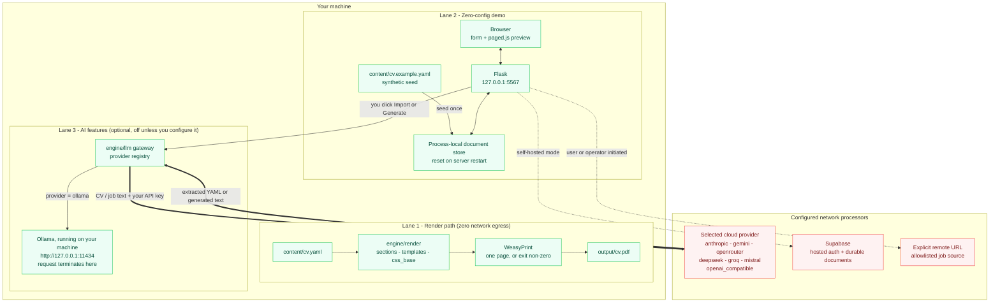

# Data Flow

Where your CV data goes depends on which mode you run. The CLI renderer is a
file-backed, network-free path. The zero-config browser demo uses loopback HTTP
and process memory. The durable editor uses operator-configured hosted
processors. AI and remote imports are separate, explicit outbound actions.

## Lane 1 - the render path

`python3 engine/build.py` reads the gitignored `content/cv.yaml` when it exists,
otherwise it uses the bundled synthetic `content/cv.example.yaml`. It renders
HTML through `engine/render` and hands it to WeasyPrint, which writes
`output/cv.pdf`. If the result runs past one A4 page the build exits non-zero
and names the offending heading.

This lane opens no sockets. Fonts are vendored under `design/fonts/`, the CSS is
generated in-process, and there is no telemetry, no update check, and no
analytics call. You can run it with networking disabled entirely.

## Lane 2 - the zero-config demo editor

`ONEPAGER_DEMO_MODE=true python3 tools/editor/server.py` binds Flask to
`127.0.0.1:5567` - loopback, not `0.0.0.0`. The server seeds the synthetic
`content/cv.example.yaml` into `tools/editor/local_demo_store.py`. CVs, jobs,
letters, and account-scoped demo state then live only in that process. Saves
survive a browser reload while the server runs, but stopping the process resets
the store to the bundled sample.

Preview and PDF requests materialize the selected YAML blob into a temporary
file for the renderer and remove that file after use. They do not write the
edited document back to `content/cv.yaml`. A successful mutating demo response
identifies the document-store boundary with
`X-OnePager-Demo-Write: server-process-memory`.

The demo's document and preview loop uses only loopback HTTP. Explicit outbound
features remain outbound: a configured cloud AI provider receives the selected
text, and job URL ingestion fetches only operator-allowlisted sources. Theme
presets are reviewed files bundled under `themes/`; the server neither imports
them from remote URLs nor writes tenant data into that directory.

## Lane 3 - the AI features, and where they send data

AI import, extraction, tailoring, and cover-letter generation are explicit
actions. Nothing is sent in the background, and none of it runs unless you have
selected a provider and supplied the credential or endpoint it needs.

When you do trigger one, the relevant text - the CV content and, where
applicable, the job description - is sent to the provider you selected. Which
provider that is determines whether anything leaves your machine at all:

| Provider | Endpoint | Leaves your machine? |
|---|---|---|
| `ollama` | `http://127.0.0.1:11434` (local-only, override with `ONEPAGER_OLLAMA_BASE_URL`) | No - the request terminates on your host |
| `anthropic` | Anthropic API | Yes |
| `gemini` | Google Gemini API | Yes |
| `openrouter` | `https://openrouter.ai/api/v1` | Yes |
| `deepseek` | `https://api.deepseek.com` | Yes |
| `groq` | `https://api.groq.com/openai/v1` | Yes |
| `mistral` | `https://api.mistral.ai/v1` | Yes |
| `openai_compatible` | whatever public HTTPS base URL you configure via `ONEPAGER_OPENAI_COMPATIBLE_BASE_URL` | Yes, to the endpoint you named |

**You choose where the AI runs.** Pick `ollama` and the AI lane collapses back
onto your machine. Pick any of the other seven and the text you submit is
processed by that vendor under that vendor's terms, on your account when you
bring your own key. Both are supported, first-class configurations; the honest
statement is that the destination is your decision, not a property of this tool.

Base URLs are validated before a client is constructed. The `ollama` provider is
restricted to a local address and `openai_compatible` to public HTTPS, so
neither can be turned into a private-network fetch primitive.

## Explicit non-AI fetches

One non-AI feature can make outbound requests:

- Job URL ingestion is disabled unless the operator allowlists the target host.
  LinkedIn blind scraping, stored LinkedIn cookies, and stealth automation are
  outside the supported path; see
  [`docs/job-ingestion-policy.md`](job-ingestion-policy.md).

These are explicit actions, not background traffic.

## Processors in a hosted deployment

The durable editor is a self-hosted multi-tenant web app (see
[`DEPLOY.md`](../DEPLOY.md)). Supabase supplies authentication and per-user
document storage. The other processors below are optional. The operator must
remove unused rows and document the regions and safeguards actually configured:

| Processor | Purpose | Location / safeguard |
|---|---|---|
| Supabase | Database, authentication, storage of accounts and documents, only when configured | Region and safeguards selected by the operator |
| Anthropic | AI generation and extraction, only when Claude is selected | Provider terms, region, and safeguards selected by the operator or key owner |
| Google Gemini | AI generation and extraction, only when Gemini is selected | Provider terms, region, and safeguards selected by the operator or key owner |
| Cloudflare R2 | Rendered-PDF storage, only when all R2 settings are configured | Location and safeguards selected by the operator |
| Resend | Sign-in email delivery, only when configured | Location and safeguards selected by the operator |
| PostHog | Product analytics, only when explicitly enabled | Hosting mode, region, and safeguards selected by the operator |

Lane 1 reaches none of these processors. The zero-config demo reaches none for
its core document and preview loop; it can still reach a provider or remote URL
when the user explicitly invokes one of the outbound features described above.

## Hosted account erasure

The production Compose profile runs a separate service-role erasure worker.
An account-deletion request hides product data immediately and remains
cancellable strictly before D+30. At D+30 an atomic database claim makes the
request irrevocable. The worker then:

1. deletes every object below the account UUID prefix in R2, when configured;
2. deletes only that UUID's directory in the persistent photo volume;
3. validates that it still owns the database claim;
4. admin-hard-deletes the Supabase Auth user, triggering foreign-key cascades
   for owned database rows.

An R2, filesystem, or claim failure prevents the worker from initiating the
Auth deletion. After the Auth Admin call, the worker verifies that the owner
profile cascade completed. This postcondition also resolves an ambiguous
network response when Supabase committed the deletion before the response was
lost; a still-present profile is deferred for retry. Logs expose aggregate
counts and exception classes only, never account IDs, object keys, claim
tokens, credentials, or exception messages.

## What this document does not claim

It makes no blanket privacy guarantee, because none would be true. Point the AI
lane at a cloud provider and your CV text is transmitted to that vendor - that
is the feature working as designed. Configure hosted mode and the editor uses
the processors the operator selected. Trigger a remote import and the server
fetches the validated target. What this document does claim, and what the code
backs up, is narrower and checkable: the CLI renderer has no network egress,
the zero-config demo stores documents in process memory and keeps its core loop
on loopback, AI calls and remote imports are explicit, and local inference is a
supported configuration rather than a footnote.
